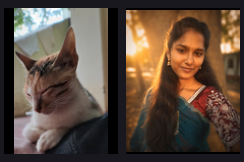

# Multi-Image Encryption (MIE) on FPGA — SDRAM + VGA demo (DE2-115)

Hardware implementation of a chaos-based **Multi-Image Encryption (MIE)** scheme in Verilog for the
Terasic **DE2-115** board (Intel/Altera Cyclone IV E `EP4CE115F29C7`). Two portrait photos are stored in
the external SDRAM, encrypted and decrypted on the FPGA by the MIE core, and shown live on a VGA monitor.



## Highlights

- 256-byte block cipher core combining XOR key streams, a Josephus permutation, a Process-Queue S-box and a
  Rule 30 cellular-automaton shuffle (S-box + permutation) — see [How the cipher works](#how-the-cipher-works).
- Keys, S-boxes and inverse tables are generated on-chip from a chaotic 8-D system; initialisation is fully
  deterministic, so data encrypted before a power cycle can be decrypted after it.
- Images live in **external SDRAM** (one 32-bit word per pixel); on-chip M9K memories are used only as VGA scan-out caches.
- Live VGA output of *Original → Encrypted → Decrypted* for both images, driven by three push buttons.
- Built-in self-test reported on the board LEDs.

## Repository layout

```
.
├── rtl/        Synthesizable Verilog (25 files; top level: mie_sdram_vga_top.v)
├── tb/         Testbenches for the MIE core (mie_core_tb, selftest_tb)
├── sim/        ModelSim/Questa .do scripts and an Icarus Verilog runner
├── quartus/    Quartus Prime project (.qpf/.qsf), timing constraints (.sdc), boot-image MIF
├── tools/      make_images.py — converts two JPG/PNG photos into the boot-image files
├── assets/     The two source photographs
└── docs/       Image preview and build history / repair notes
```

## Board operation

| Control | Action |
|---|---|
| `KEY0` | Reset. SDRAM initialises, both source images are copied into SDRAM and read back. |
| `KEY1` | Encrypt both images. Encrypted pixels are written to SDRAM and copied to the VGA cache. |
| `KEY2` | Decrypt both encrypted images (ignored until encryption has finished). |

**VGA layout (640 × 480)**

- Before `KEY1`: the two originals side by side (280 × 360 panels).
- After `KEY1`: two rows, *Original | Encrypted* per image (186 × 240 panels).
- After `KEY2`: two rows, *Original | Encrypted | Decrypted* per image (186 × 240 panels).

**Status LEDs (`LEDG`)**

| LEDG | Meaning |
|---|---|
| 0 | SDRAM initialisation complete |
| 1 | Both originals loaded into SDRAM and read back |
| 2 | MIE core ready |
| 3 | MIE engine or result-cache DMA busy |
| 4 | Both encrypted images ready |
| 5 | Both decrypted images ready |
| 6 | MIE built-in self-test complete |
| 7 | MIE built-in self-test passed |
| 8 | MIE built-in self-test failed |

## How the cipher works

`mie_core.v` processes one 256-byte block at a time (`A`/`B` are ping-pong block buffers):

```
ENCRYPT  A --XOR K1--> B --Josephus perm--> A --XOR K2--> B
            --Process-Queue S-box--> A --Rule30 (XOR K3 + perm)--> B
DECRYPT  A --Rule30^-1 (perm^-1 + XOR K3)--> B --S-box^-1--> A
            --XOR K2--> B --Josephus perm^-1--> A --XOR K1--> B
```

## Architecture

| Block | Files |
|---|---|
| Top level, board I/O | `mie_sdram_vga_top.v` |
| MIE core and stages | `mie_core.v`, `stage_process.v`, `simple_pass.v`, `rule30_stage_top.v` |
| Key generation (chaotic 8-D system) | `key_generator_top.v`, `key_gen_triple.v`, `key_expand.v`, `chaotic8d_core.v`, `derivative_function.v`, `fixed_mult.v` |
| Permutation / S-box builders | `josephus_seq_gen.v`, `josephus_permute.v`, `process_queue_sbox.v`, `rule30_generator.v`, `rule30_shuffle_engine.v`, `rule30_inverse_builder.v`, `random_extractor.v` |
| SDRAM path | `sdram_ctrl32.v`, `sdram_image_loader.v`, `mie_sdram_engine.v`, `sdram_cache_dma.v` |
| Display | `img_display_2img.v` |
| Memories | `blk_ram.v`, `ram24.v` |

### Image geometry and memory map

- Each image is **112 × 144** = 16,128 pixels = 48,384 RGB bytes = **189 complete 256-byte MIE blocks**.
- One SDRAM word holds one pixel: bits `[23:0]` = `RRGGBB`, bits `[31:24]` unused.

| Region | SDRAM word addresses | Contents |
|---|---:|---|
| Original | 0 – 32,255 | Image 1 followed by Image 2 |
| Encrypted | 32,256 – 64,511 | Encrypted Image 1 followed by Image 2 |
| Decrypted | 64,512 – 96,767 | Decrypted Image 1 followed by Image 2 |

Image 2 starts at word offset 16,128 inside each region.

### Memory and speed choices

- The boot image memory in `sdram_image_loader.v` is an explicit Cyclone IV `altsyncram` true dual-port M9K
  (32,768 × 24 bit, initialised from `quartus/images2.mif`; 32,256 valid words + 512 zero-padding words). After
  the SDRAM readback it is reused as the *original-image* VGA cache.
- Encrypted and decrypted VGA caches are 15-bit-addressed M9K memories.
- The engine assembles the three output bytes (R, G, B) into one 24-bit pixel and writes it in a single SDRAM
  transaction (3× fewer writes).
- The VGA scaler uses fixed-point reciprocal multiplication instead of dividers.

## Getting started

### Build (Quartus Prime Lite 24.1 or compatible)

1. Open `quartus/mie_sdram_vga_top.qpf`.
2. Confirm device `EP4CE115F29C7` and top-level entity `mie_sdram_vga_top`.
3. **Processing → Start Compilation** (do a fresh build; no `db/` or `output_files/` are stored in this repo).
4. Check the Fitter and timing reports, then program `quartus/output_files/mie_sdram_vga_top.sof` onto the DE2-115.

The pin assignments for the DE2-115 are in `quartus/mie_sdram_vga_top.qsf`; clock constraints and the
multicycle exceptions for the slow table/key builders are in `quartus/mie.sdc`.

### Simulate the MIE core

Icarus Verilog (from the repository root):

```bash
./sim/run_iverilog.sh
```

ModelSim/Questa (from `sim/`):

```tcl
do run_core_test.do
do run_selftest.do
```

Expected: `PASS: mie_core encrypt/decrypt verified.` and `RESULT PASS: hardware self-test passes`.
The testbenches cover the cipher core only; the SDRAM/VGA path uses an Altera `altsyncram` primitive and needs
the Quartus (`altera_mf`) simulation libraries.

### Use your own photographs

```bash
pip install pillow numpy
python tools/make_images.py assets/image1.jpg assets/image2.jpg --width 112 --height 144 --out quartus
```

This regenerates `quartus/images2.mif` (the file the Quartus project actually uses). The script also writes
optional HEX/BIN inspection copies, which are git-ignored. Each image is resized with its aspect ratio
preserved and centred on black. `width × height × 3` must be divisible by 256; if you change 112 × 144 you must
change the RTL parameters, cache sizes and memory map together. Recompile in Quartus afterwards.

## Verification status

| Item | Status |
|---|---|
| MIE core encrypt/decrypt round trip (`mie_core_tb`) | Passes (Icarus Verilog) |
| MIE built-in self-test (`selftest_tb`) | Passes (Icarus Verilog) |
| Source-level checks (image geometry, 189-block count, SDRAM region non-overlap, MIF depth/padding, QSF paths) | Done |
| Quartus compilation (Quartus Prime Lite 24.1) | Done by the author on a separate machine |
| Physical DE2-115 SDRAM / VGA test | Done by the author; design works on the board |

The design has been compiled and run on a DE2-115 board. `docs/BUILD_HISTORY.md` is a historical log written before that testing, so its "not performed" remarks are out of date. Build history and the Quartus repair notes are in [`docs/BUILD_HISTORY.md`](docs/BUILD_HISTORY.md).

## License

No license has been chosen yet — add a `LICENSE` file before sharing the repository publicly.
